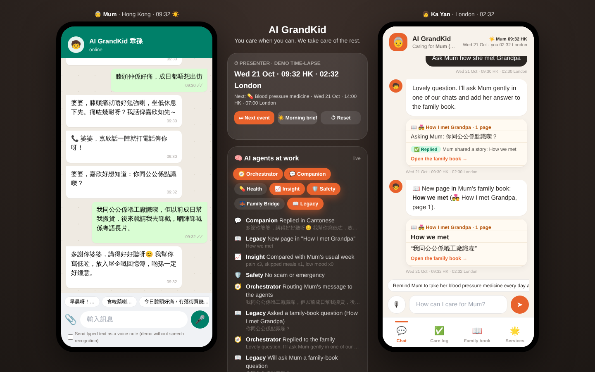
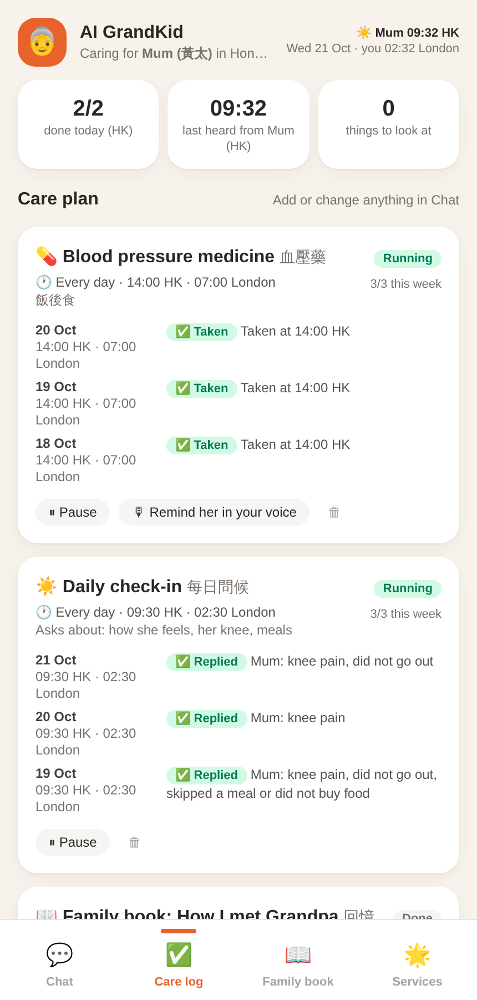
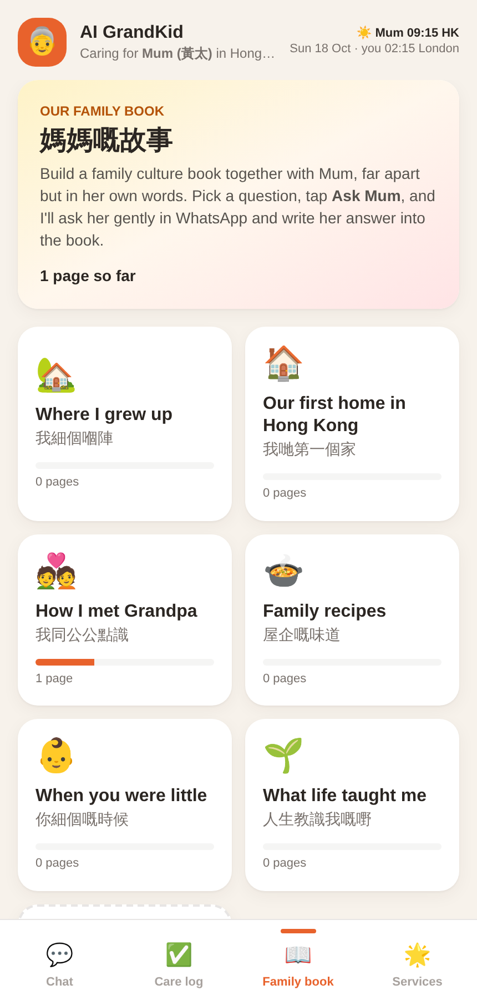
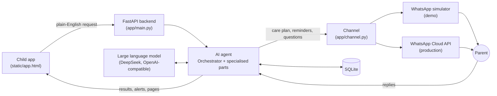

# AI GrandKid

**You care when you can. We take care of the rest.**

AI GrandKid makes it easy for children living abroad to care for their ageing parents in Hong Kong. The child describes the care they want in plain English, and an AI agent carries it out over WhatsApp in Cantonese, then reports back.

**Demo video:** [DEMO VIDEO LINK]
**Team:** [TEAM NAMES]
**Event:** GenAI Hackathon Hong Kong 2026 · Track: Smart Living, Culture & Belonging



---

## What it does

| Who | What they use |
|---|---|
| **Parent** (Hong Kong) | WhatsApp only. Nothing new to learn. In this repo the parent side is a WhatsApp-style simulator connected to the real backend; the production path uses Meta's official WhatsApp Cloud API (`app/whatsapp.py`). |
| **Child** (abroad) | The AI GrandKid web app, with four tabs: |

- **Chat:** describe the care in your own words, e.g. *"Remind Mum to take her blood pressure medicine every day at 2pm"* or *"Ask Mum how she met Grandpa"*. The AI agent turns it into a care plan, a message, or a family-book question. It also posts alerts, missed-medicine notes, new book pages and a morning brief.
- **Care log:** every task and every result in both time zones (taken, replied, reminded again, missed), plus a live list of what the AI did.
- **Family book:** themed chapters of the parent's stories, recipes and values, kept in their own words with an English translation. Tap **Ask Mum** on any question, or add your own questions and chapters.
- **Services:** "coming soon" cards for future extensions (hospital escort, rides, meals, home care and more). Nothing here can be booked yet.

| Care log | Family book |
|---|---|
|  |  |

---

## How to run

### 1. Install Python
Python **3.10 or newer** from [python.org](https://www.python.org/downloads/). On Windows, tick **"Add Python to PATH"** during installation.

### 2. Download this repo
Click the green **Code** button → **Download ZIP**, then unzip it.

### 3. Start the app
- **Windows:** double-click `start.bat`
- **Mac / Linux:** open a terminal in the folder and run `./start.sh`

The first run creates a virtual environment and installs dependencies (2–3 minutes), then opens the demo view at **http://localhost:8000/demo**.

### 4. (Optional) Add an AI key to see the real AI agent
> **No API key is included in this repo.** Without a key the app runs in **mock mode**: every screen works, but the AI replies are fixed examples. To see the real AI agent shown in our demo video, add your own key.

1. After the first run, the folder contains a file called `.env` (created automatically from `.env.example`).
2. Open `.env` in any text editor and paste your key after `LLM_API_KEY=`:
   ```
   LLM_API_KEY=your-api-key
   ```
3. Save, close the terminal window and start the app again.

The key is for [DeepSeek](https://platform.deepseek.com) by default. Any OpenAI-compatible provider works: change `LLM_BASE_URL` and `LLM_MODEL` in `.env`.

The terminal shows which mode is active:
- `AI: deepseek-chat @ https://api.deepseek.com/v1` (real AI)
- `AI: MOCK (no API key, rule-based)` (mock mode)

---

## Try it in 2 minutes

Open **http://localhost:8000/demo**. Left: the parent's WhatsApp (Hong Kong). Middle: the presenter panel and live AI agent activity. Right: the child's app (London). The parent's replies are quick-reply chips above the WhatsApp keyboard: tap one, then press Enter.

1. In the child's chat, type `Remind Mum to take her blood pressure medicine every day at 2pm after lunch` → **Confirm**. The parent's phone shows the reminder at 14:00. Tap **已食藥 ✅**.
2. Type `Check in with Mum every morning at 9:30 and ask about her knee` → **Confirm**. Reply with the chip `今日膝頭好痛，冇落街買餸`.
3. Press **⏭ Next event** four times, tapping **已食藥** at each medicine reminder and replying with the two other knee chips at each check-in. An alert appears: *"Knee pain mentioned 3 times this week"*. Tap **I'll call her**.
4. Type `Ask Mum how she met Grandpa` and reply with the chip `我同公公係喺工廠識㗎…`. Tap the 📖 card to open the new family-book page.
5. Open **Care log** and **Services**. Press **☀️ Morning brief** for a summary of the parent's day.

**↺ Reset** in the middle panel starts again from empty.

> **Time-lapse:** to show several days in a few minutes, the demo uses a virtual clock. Confirming a plan or pressing **⏭ Next event** jumps the clock to the next scheduled moment. Set `DEMO_INSTANT=false` in `.env` to run in real time.

---

## How it works



The AI agent is one system made of specialised parts. They appear by name in the demo's agent panel:

| Part | What it does | Uses |
|---|---|---|
| **Orchestrator** | Turns the child's message into structured actions: a care plan, a message, a family-book question, or an honest "coming soon" reply | LLM |
| **Companion** | Writes warm Cantonese check-ins and replies to the parent | LLM |
| **Health** | Runs the schedule: reminders, a follow-up after 30 minutes, marks doses missed | Rules |
| **Insight** | The LLM extracts signals (e.g. knee pain) from the parent's messages; a rule raises an alert when a problem repeats (e.g. pain 3 times in 7 days) | LLM + rules |
| **Safety** | Detects scams and emergencies; a fixed guard always adds the 18222 anti-scam hotline or 999 wording | LLM + rules |
| **Family Bridge** | Sends alerts and the morning brief to the child | LLM + rules |
| **Legacy** | Turns the parent's stories into bilingual family-book pages | LLM |

We use the language model for understanding and writing, and fixed rules for anything that must be reliable, such as medicine timing. The model is not trained by us; it is any OpenAI-compatible model (currently DeepSeek), switchable in `.env`.

More detail: [docs/ARCHITECTURE.md](docs/ARCHITECTURE.md) · [docs/API.md](docs/API.md)

---

## Scope

| Status | What |
|---|---|
| **Working** | Backend and database, AI agent with LLM, care plans, reminders and follow-ups, alerts, scam guard, family book, morning brief, Care log |
| **Simulated for the demo** | The parent's WhatsApp (simulator on the real backend), the time-lapse clock |
| **Built, needs credentials** | Real WhatsApp via Meta's Cloud API (`WHATSAPP_*` settings); voice-note transcription (needs an ASR key, `ASR_PROVIDER`) |
| **Not built yet** | Everything in the Services tab |

---

## Project structure

```
aigrandkid/
├── app/
│   ├── main.py          FastAPI routes: pages, child app API, family book, demo controls, simulator, WhatsApp webhook
│   ├── coordinator.py   Child's chat: plain-English request -> structured actions (Orchestrator)
│   ├── care.py          Care tasks: schedule, carry out, follow up, link the parent's replies (Health)
│   ├── agents.py        Parent's messages: Safety, signals, Insight, Companion reply; alerts; morning brief
│   ├── book.py          Family book: chapters, questions, bilingual pages (Legacy)
│   ├── prompts.py       All LLM prompts
│   ├── llm.py           OpenAI-compatible LLM client; mock mode when no key is set
│   ├── mock_ai.py       Rule-based replies used in mock mode or if an LLM call fails
│   ├── timelapse.py     Demo time-lapse: jump to the next event, morning brief
│   ├── clock.py         Virtual clock used everywhere in the app
│   ├── scheduler.py     Background tick every 20 s that runs due care tasks
│   ├── channel.py       Sends messages to the parent (simulator or WhatsApp)
│   ├── whatsapp.py      Meta WhatsApp Cloud API client
│   ├── speech.py        Optional speech-to-text, text-to-speech and audio conversion
│   ├── chatlog.py       The child's chat history
│   ├── events.py        Activity log for the agent panel and Care log
│   ├── seed.py          Fresh demo family (profile + family-book template)
│   ├── db.py            SQLite schema and helpers
│   └── config.py        Settings read from .env
├── static/
│   ├── app.html         Child's app (Chat, Care log, Family book, Services)
│   ├── simulator.html   Parent's WhatsApp-style simulator
│   ├── demo.html        Side-by-side demo view with presenter controls
│   └── tw.css           Prebuilt Tailwind CSS
├── scripts/
│   ├── selftest.py      End-to-end test of the demo flow
│   └── test_whatsapp.py Sends one test message with real WhatsApp credentials
├── docs/                Architecture, API reference, screenshots
├── .env.example         Settings template (copied to .env on first start)
├── requirements.txt
└── start.bat / start.sh One-click start
```

---

## Tech stack

Python 3.10+ · FastAPI · Uvicorn · SQLite · APScheduler · plain HTML/JavaScript with prebuilt Tailwind CSS · OpenAI-compatible LLM client (DeepSeek `deepseek-chat` by default) · Meta WhatsApp Cloud API (production path) · edge-tts and ffmpeg (optional voice)

---

## Configuration

All settings live in `.env` (created from `.env.example` on first start). The main ones:

| Setting | Default in `.env.example` | Meaning |
|---|---|---|
| `LLM_API_KEY` | *(empty)* | Your API key. Empty = mock mode |
| `LLM_BASE_URL` | `https://api.deepseek.com/v1` | Any OpenAI-compatible endpoint |
| `LLM_MODEL` | `deepseek-chat` | Model name |
| `CHILD_LANG` | `English` | Language the AI uses with the child |
| `DEMO_INSTANT` | `true` | Time-lapse: confirmed plans happen immediately |
| `RESET_ON_START` | `true` | Start with an empty demo every time |
| `WAKE_START` / `WAKE_END` | `08:30` / `21:30` | Parent's waking hours (HK); no messages outside them |
| `MORNING_DELIVERY` | `09:15` | Messages written while the parent sleeps arrive at this HK time |
| `BRIEF_TIME` | `07:30` | Morning brief time in the child's time zone |
| `PARENT_TZ` / `CHILD_TZ` | `Asia/Hong_Kong` / `Europe/London` | Time zones |
| `ASR_PROVIDER` | `none` | Speech-to-text: `none`, `openai` or `tencent` |
| `TTS_ENABLED` | `false` | Cantonese voice replies (needs ffmpeg) |
| `WHATSAPP_*`, `DEMO_PARENT_WA` | *(empty)* | Real WhatsApp. Empty = use the simulator |

For real use instead of a demo, set `DEMO_INSTANT=false` and `RESET_ON_START=false`.

---

## Testing

With the app running, open a second terminal in the project folder:

```
# Windows
.venv\Scripts\activate
# Mac / Linux
source .venv/bin/activate

python scripts/selftest.py
```

It runs 23 end-to-end checks covering the demo flow (care plans, reminders, follow-ups, alerts, scam guard, family book, honest scope and morning brief) and resets the app afterwards. Use `--url` to test another address.

---

## Troubleshooting

| Problem | Fix |
|---|---|
| Terminal says `AI: MOCK` | `LLM_API_KEY` is empty in `.env`, or the file was saved as `.env.txt` |
| `python` not found (Windows) | Reinstall Python and tick "Add Python to PATH" |
| Port 8000 already in use | Close the other program, or run `uvicorn app.main:app --port 8001` |
| "ffmpeg not found" warning | Only needed for voice notes. Install with `winget install ffmpeg` (Windows) or `brew install ffmpeg` (Mac) |
| Want to start over | Press **↺ Reset** in the demo view, or restart the app |
