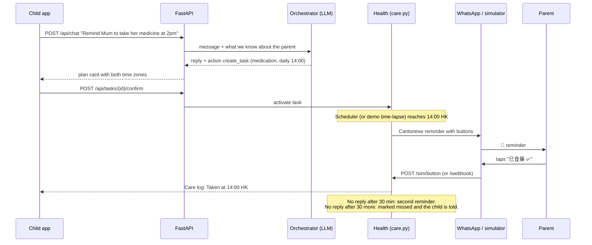
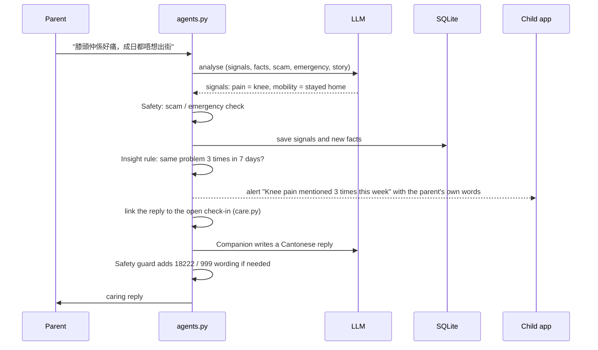
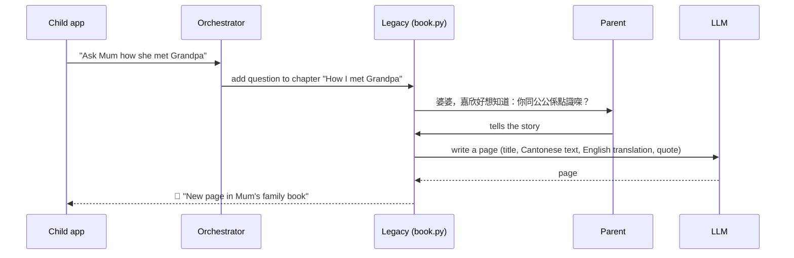

# Architecture

AI GrandKid is a single FastAPI application with a SQLite database. The child uses a web app; the parent uses WhatsApp (a WhatsApp-style simulator in the demo). An AI agent sits in between: it uses a large language model for understanding and writing, and fixed rules for scheduling and safety.

## Components

| Component | File(s) | Role |
|---|---|---|
| Web server | `app/main.py` | HTTP routes for the child app, simulator, demo controls and WhatsApp webhook |
| Orchestrator | `app/coordinator.py`, `app/prompts.py` | Reads the child's message and returns a reply plus structured actions |
| Health / care engine | `app/care.py` | Creates care tasks, carries out due slots, follows up, links the parent's replies to tasks |
| Parent pipeline | `app/agents.py` | Every parent message: Safety, signals, Insight, Legacy, Companion reply; alerts; morning brief |
| Legacy | `app/book.py` | Family-book chapters, questions and bilingual pages |
| Scheduler | `app/scheduler.py` | Background tick every 20 seconds that runs due care tasks and follow-ups |
| Clock and time-lapse | `app/clock.py`, `app/timelapse.py` | Virtual clock; in demo mode jumps to the next scheduled event |
| Channel | `app/channel.py`, `app/whatsapp.py` | Stores every message and sends it through the simulator or the WhatsApp Cloud API |
| LLM client | `app/llm.py`, `app/mock_ai.py` | OpenAI-compatible client; rule-based mock when no key is set or a call fails |
| Front end | `static/app.html`, `static/simulator.html`, `static/demo.html` | Child app, parent simulator, side-by-side demo view (they poll `/api/state` and `/sim/messages`) |

## Flow 1: a child's request becomes care in the parent's day

Messages the child writes while the parent is asleep are held until `MORNING_DELIVERY` (default 09:15 HK). Proactive messages are only sent between `WAKE_START` and `WAKE_END`.

## Flow 2: a parent's message is understood and checked

The Safety guard is deterministic code: if a message looks like a scam or emergency, the reply always contains the 18222 anti-scam hotline or 999 wording, whatever the model wrote.

## Flow 3: a family-book question becomes a page

Stories the parent shares on her own, without being asked, are also detected and saved as pages. Everyday care replies are not; they go to the Care log.

## Database (SQLite, `data/aigrandkid.db`)

| Table | Stores |
|---|---|
| `parents` | The family: parent name and nickname, WhatsApp id, child's name, city and time zone |
| `messages` | The parent's WhatsApp conversation (both directions) |
| `chat` | The child's chat with the AI agent, including cards (plans, alerts, book pages, brief) |
| `care_tasks` | Care plans the child asked for: kind, schedule, details, status |
| `care_runs` | Each time a task was carried out: slot, status (sent, taken, answered, missed…), outcome |
| `signals` | Health and mood signals extracted from the parent's messages, with her words as evidence |
| `facts` | Long-term facts about the parent, used to personalise replies |
| `alerts` | Alerts to the child: kind, level, evidence, suggested actions, status |
| `digests` | Morning briefs |
| `book_chapters` | Family-book chapters (template + chapters the family adds) |
| `book_questions` | Questions per chapter: from the template, the child, or follow-ups |
| `book_entries` | Family-book pages: Cantonese story, English translation, quote, original answer |
| `events` | Activity log of the agent's parts (agent panel and "What the AI did") |
| `processed` | WhatsApp message ids already handled (prevents duplicates) |
| `kv` | Small key-value settings (e.g. busy flags, last brief date) |

## Time and the demo clock

All times are stored in UTC and shown in both the parent's and the child's time zone. `app/clock.py` holds a single offset applied to "now" everywhere. With `DEMO_INSTANT=true`, confirming a plan or pressing **⏭ Next event** moves the clock to the next scheduled moment (`app/timelapse.py`), so several days can be shown in a few minutes. With `DEMO_INSTANT=false`, the scheduler runs everything in real time and sends the morning brief at `BRIEF_TIME` in the child's time zone.
